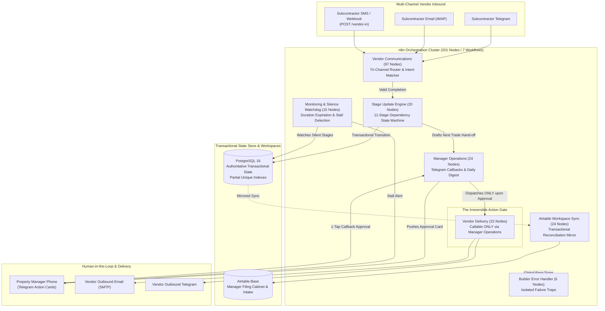

# Autonomous Make-Ready Sequencing & Trade Coordination Engine

[](https://n8n.io)
[](https://www.postgresql.org)
[](https://www.docker.com)
[](https://core.telegram.org/bots/api)
[](https://airtable.com)
[](#the-single-path-to-irreversible-action)

> **An event-driven multi-trade workflow orchestration engine that compresses residential apartment turnover from 11+ days down to 3-5 days by eliminating coordination lag, enforcing strict trade dependencies, and providing topological human-in-the-loop safety.**

---

## The Operational Problem

In US residential property management, unit turns represent one of the largest controllable operational drains:
* **The Slowness**: 49% of property management operators report turnover taking 9 days or longer, with typical turns stretching 10-14 days (*State of the PM Industry Report*). Best practice benchmarks demonstrate that turns can be completed in 3-5 days.
* **The Vacancy Cost**: Every single day an apartment sits empty between residents costs **$50-$100 in unrecoverable rent loss** (*US Tech Automations*). For a 300-unit portfolio running 120 turns per year, 4 lost coordination days per turn burns roughly **$24,000 annually**.
* **Coordination Lag, Not Trade Work**: A painter finishes Tuesday at 2:00 PM and drives away without calling. The flooring crew could start Wednesday morning, but the coordinator does not learn the paint is finished until Thursday afternoon. The flooring crew is now booked on another job and cannot arrive until Monday. The unit sat empty for 5 days: 2 days of work and 3 days of silence.
* **Costly Sequencing Errors**: 20-25% of turnover repairs require a second visit due to improper sequencing (e.g., cleaning before drywall repairs, or laying carpet before painting), resulting in 30-50% expedited trade surcharges (*NAA Benchmarks*).

### The Solution
This system is an **autonomous state machine and dispatch engine** that manages the entire multi-trade chain:
1. Ingests vendor completions across **Telegram, Email (IMAP), and REST Webhooks** without requiring subcontractors to register for new software portals.
2. Interprets incoming messages using OpenAI with strict JSON schemas and deterministic unit-matching scoring.
3. Automatically transitions the unit through an **11-stage dependency graph** (repairs -> paint -> flooring -> clean -> QA inspection).
4. Drafts the next trade's work order and presents it to the property manager as an interactive Telegram card.
5. Monitors trade silence during business hours, raising an alert only when expected stage durations are exceeded.

---

## System Architecture



---

## Core Engineering Highlights & Guarantees

### 1. The Single Path to Irreversible Action
Contacting a subcontractor is an irreversible operational action. A duplicate or incorrect dispatch wastes hundreds of dollars and damages vendor relationships.
* Across all **201 nodes in 7 workflows**, exactly two nodes can contact a vendor: `Delivery Send Vendor Email` (the only `emailSend` node in the repository) and `Delivery Send Vendor Telegram`.
* Both nodes reside exclusively inside `demo-vendor-delivery.json`.
* **Zero Trigger Invariant**: `Vendor Delivery` has **no trigger of its own**. Its sole entry point is an `Execute Sub-workflow Trigger`.
* Tracing the call graph reveals that only one node in the entire system invokes it: `Manager Call Vendor Delivery Dispatcher` inside `Manager Operations`.
* That call is strictly downstream of an authenticated Telegram callback from the property manager's phone.
* **Result**: It is topologically impossible for a timer, schedule, or autonomous AI loop to message a vendor without human authorization.

### 2. Strict 11-Stage Dependency State Machine
Trade handoffs follow strict physical and operational sequencing rules:

| # | Stage Name | Expected Duration | Strict Predecessors Required |
| :-: | :--- | :---: | :--- |
| **0** | Notice Received | None | None |
| **1** | Pre-Move-Out Inspection | 48 Hours | None |
| **2** | Move-Out / Keys Returned | None | None |
| **3** | Inspection & Punch List | 24 Hours | Move-Out (Stage 2) |
| **4** | Trash-Out | 24 Hours | Move-Out (Stage 2) |
| **5** | Repairs & Maintenance | 72 Hours | Move-Out (Stage 2) |
| **6** | Paint | 48 Hours | Move-Out (Stage 2), Repairs (Stage 5) |
| **7** | Flooring | 48 Hours | Move-Out (Stage 2), Paint (Stage 6) |
| **8** | Deep Clean | 24 Hours | Move-Out, Repairs, Paint, Flooring |
| **9** | QA Walkthrough & Photos | 12 Hours | Move-Out, Deep Clean (Stage 8) |
| **10** | Relist (Rent Ready) | None | Move-Out, QA Walkthrough (Stage 9) |

* Paint strictly precedes flooring to avoid overspray or paint damage to new carpeting.
* Deep cleaning strictly requires all trades (repairs, paint, flooring) to be completed.
* Deliberately skipped stages are recorded as satisfied decisions, allowing legitimate bypasses while blocking accidental out-of-order dispatches.

### 3. The Silence Watchdog (Intelligent Inactivity Detection)
The most expensive part of a turn is unnoticed silence.
* The `Monitoring` workflow scans active turns every 15 minutes during business hours against stage-specific expected durations.
* **Deliberate Restraint**: Stages that depend on outside events (Notice Received, Move-Out, and Relist) carry no expected duration and **never trigger alerts**.
* **Internal Team Exclusion**: In-house staff stages are excluded from the vendor watchdog to avoid alert fatigue.
* When a vendor goes quiet beyond their expected duration, the system triggers exactly one consolidated alert to the manager, presenting 1-tap options: `[Mark Done]` or `[Chase Vendor]`.

### 4. PostgreSQL 16 Authoritative State & Partial Unique Indexes
Google Sheets and basic automation tables cannot enforce transactional integrity.
* Invariants such as `uniq_one_active_stage_per_turn` are enforced via partial unique indexes at the database engine level:
  ```sql
  CREATE UNIQUE INDEX uniq_one_active_stage_per_turn 
  ON turn_stages (turn_id) 
  WHERE status = 'IN_PROGRESS';
  ```
* Prevents race conditions where two concurrent webhook calls could start overlapping stages.
* Airtable serves as a mirrored workspace for team visibility, keeping operational failure from corrupting core state.

### 5. Deterministic Unit Matching & Guardrails
* Vendor messages are scored deterministically by `Score Unit Match` based on sender phone/email identity, active assignments, and unit token matches. AI models are never allowed to assign records on intuition.
* All AI model calls use raw HTTP nodes communicating with OpenAI's Responses API under strict JSON Schema contracts (`strict: true`), eliminating parsing errors.

---

## Workflow Breakdown (201 Nodes / 7 Workflows)

| Workflow | File | Nodes | Core Responsibilities |
| :--- | :--- | :---: | :--- |
| **Vendor Communications** | `n8n-workflows/demo-vendor-communications.json` | 97 | Tri-channel router (Telegram, IMAP, API); message interpretation; unit matching; safety policy. |
| **Airtable Workspace** | `n8n-workflows/demo-airtable-workspace.json` | 24 | Ingests new turns from Airtable; reconciles state between Postgres and Airtable every 5 minutes. |
| **Manager Operations** | `n8n-workflows/demo-manager-operations.json` | 24 | Handles manager Telegram callbacks; generates 7:00 AM daily digest; runs `/health` checks. |
| **Stage Update** | `n8n-workflows/demo-stage-update.json` | 20 | Executes 11-stage ordering logic; closes completed stages; drafts the next trade's work order. |
| **Monitoring** | `n8n-workflows/demo-monitoring.json` | 15 | Silence watchdog; detects vendor stalls exceeding expected hours; dispatches single alerts. |
| **Vendor Delivery** | `n8n-workflows/demo-vendor-delivery.json` | 15 | **The Single Send Gate**. Dispatches approved messages via SMTP and Telegram with idempotency tracking. |
| **Builder Error Handler** | `n8n-workflows/demo-builder-error-handler.json` | 6 | Intercepts system exceptions, logging context and notifying the engineering channel. |

---

## Tech Stack

* **Orchestration**: [n8n v2.x](https://n8n.io) (Self-Hosted on Docker)
* **Authoritative Database**: [PostgreSQL 16](https://www.postgresql.org) (Dockerized with schema migrations)
* **Manager Action Surface**: [Telegram Bot API](https://core.telegram.org/bots/api) (Inline Keyboards & Callback Queries)
* **Team Workspace**: [Airtable API](https://airtable.com) (Mirrored view and turn intake)
* **Model Inference**: [OpenAI Responses API](https://platform.openai.com) (Direct HTTP with locked JSON schemas)
* **Inbound Channels**: Telegram Webhook, IMAP Email Listener, REST API (`/vendor-in`)
* **Outbound Channels**: SMTP Email, Telegram Bot API
* **Local Proxy**: Cloudflare Tunnel (`cloudflared`) for secure local webhook delivery

---

## Local Setup & Quickstart

### Prerequisites
* Docker & Docker Compose
* PowerShell (Windows) or Bash (macOS/Linux)
* Node.js v18+

### Setup Instructions

1. **Clone the Repository:**
   ```bash
   git clone https://github.com/SambhavJain26/make-ready-sequencing.git
   cd make-ready-sequencing
   ```

2. **Configure Environment:**
   ```bash
   cp .env.example .env
   ```
   Generate random passwords for Postgres and your n8n encryption key:
   ```powershell
   # In PowerShell
   [guid]::NewGuid().ToString('N')
   ```

3. **Start the Stack (Postgres & n8n):**
   ```bash
   docker compose up -d postgres n8n
   ```
   *PostgreSQL initializes automatically with all tables, constraints, and partial indexes from `./db/postgres`.*

4. **Prepare the Demo Suite:**
   Runs complete fixture reset, applies vendor contact mappings, builds the Airtable mirror, and verifies all 7 workflows:
   ```powershell
   .\scripts\prepare-demo-recording.ps1
   ```

---

## Project Structure

```
make-ready-sequencing/
├── .env.example                     # Environment template with documented defaults
├── docker-compose.yml               # Local runtime stack (Postgres 16 + n8n)
├── docker-compose.production.yml    # Production-hardened container stack with Caddy
├── db/
│   └── postgres/                    # Database init scripts, schema, and indexes
│       ├── 01-schema.sql            # Table definitions & partial unique indexes
│       ├── 02-seed.sql              # Realistic multi-building turnover fixtures
│       └── 03-reset.sql             # Idempotent database reset routines
├── n8n-workflows/                   # 7 Production workflow definitions (201 nodes)
│   ├── demo-vendor-communications.json
│   ├── demo-stage-update.json
│   ├── demo-manager-operations.json
│   ├── demo-vendor-delivery.json
│   ├── demo-monitoring.json
│   ├── demo-airtable-workspace.json
│   └── demo-builder-error-handler.json
├── scripts/                         # Operational runbooks and test helpers
│   ├── prepare-demo-recording.ps1   # 1-command reset and verification suite
│   ├── reset-demo.ps1               # Fast Postgres reset helper
│   └── setup-airtable-schema.js     # Airtable workspace generator
├── docs/                            # Comprehensive architectural specs
│   ├── build-technical-notes.md     # Node-by-node constraints & design logic
│   ├── how-the-system-works.md      # Plain-language operational breakdown
│   ├── operating-guide.md           # Step-by-step manager walkthrough
│   └── stage-8-manager-runbook.md   # Daily manager runbook
└── CASE_STUDY.md                    # Dedicated portfolio case study
```

---

## Technical Trade-offs & Engineering Decisions

| Decision | Selected Approach | Alternative Rejected | Rationale |
| :--- | :--- | :--- | :--- |
| **State Storage** | PostgreSQL 16 | Google Sheets / n8n Data Tables | Turn state requires transaction isolation and partial unique indexes (`uniq_one_active_stage_per_turn`). Spreadsheets cannot enforce these constraints and suffer from concurrent write corruption. |
| **Orchestration** | Self-Hosted n8n (Docker) | Make / Zapier | Full data sovereignty, zero per-operation execution costs, and client ownership of raw JSON workflow exports. |
| **Vendor UX** | Zero-Portal Multi-Channel | Custom Web App Portal | Subcontractors routinely ignore invites to new software portals. Supporting native SMS/Email/Telegram yields near-instant adoption without vendor onboarding friction. |
| **Action Surface** | Telegram Inline Keyboards | Custom Web Dashboard | Field property managers require immediate mobile triage. Inline cards eliminate login friction and speed approval times to under 30 seconds. |
| **Model Integration** | Direct HTTP Nodes | Built-in OpenAI / LangChain Nodes | Built-in nodes obscure JSON Schema errors. Direct HTTP provides exact payload control, strict schema enforcement, and predictable error branches. |

---

## License & Security
Private Client Build: Proprietary Intellectual Property. All vendor identities, property addresses, and contact numbers in this repository are synthetic test fixtures.
